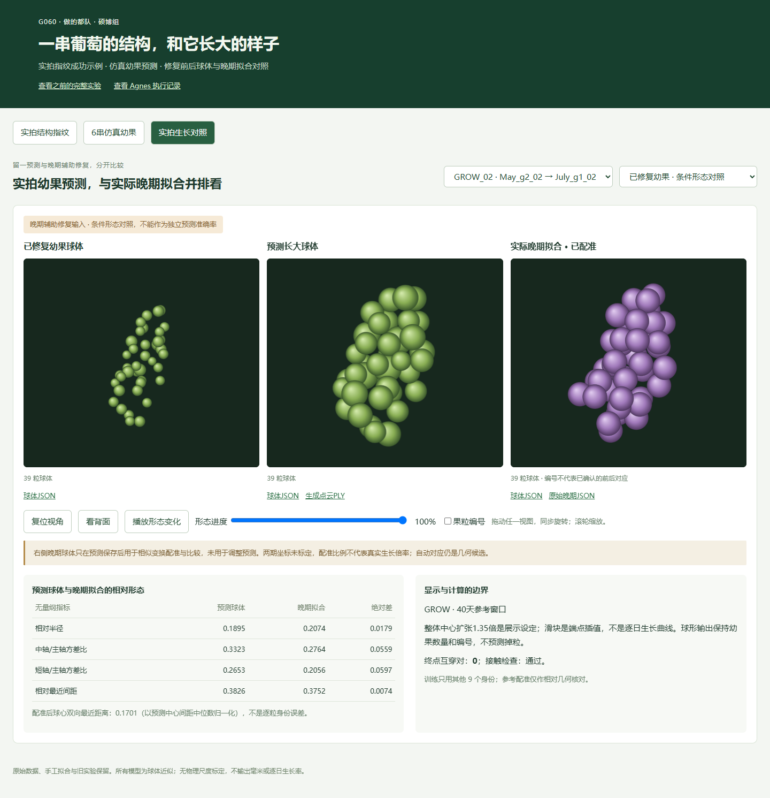

# 葡萄结构指纹与跨期形态分析智能体

G060 · 做的都队 · 硕博组 · Agnes Harness 参赛作品

以果粒几何排布作为结构指纹，结合仿真训练的圆心检测器完成照片检索；用早晚期球体拟合学习相对形态，展示幼果、预测结果和实拍晚期拟合的三栏对照。AGH 中的 Agnes 调用科研程序、检查结果和讨论；代码实现、适配与页面由 Codex 协助完成。



## 下载后查看

需要 Python 3.9 或以上。查看冻结案例不需要科学计算依赖、原始视频或 API Key。

```bash
git clone https://github.com/StarrySerenity/grape-agh-g060.git
cd grape-agh-g060
python -m http.server 8870 --bind 127.0.0.1
```

浏览器访问 **http://127.0.0.1:8870/web/showcase.html**。Windows 也可双击 `Start-Demo.cmd`。

- 实拍指纹：FP3_11 的 3 张成功照片，可查看检测圆、几何对应和指纹下载。
- 仿真幼果：6 串、306 粒，支持同步旋转、端点插值和球体下载。
- 实拍生长：18 对配对，原始幼果与晚期辅助修复两种输入，默认 GROW_02。

## 代码与结果

| 位置 | 内容 |
| --- | --- |
| `web/`、`data/showcase-20261014/`、`results/showcase-20261014.*` | 便携展示、球体、PLY 与指纹结果 |
| `experiments/combined200/training/` | 联合训练、检测推理、几何匹配代码与本轮选中权重 |
| `experiments/combined200/experiment.py` | 仿真门限标定、仿真回归、实拍迁移测试 |
| `experiments/combined200/upstream/` | 实验使用的上游源码快照，保留原路径约定 |
| `experiments/growth/` | 相对形态预测器、种子生成器、实拍前后比较与冻结输入 |
| `plugin/`、`run-agent.mjs`、`install-plugin.mjs` | AGH 插件与运行脚本 |
| `evidence/`、[执行摘要](docs/AGH_EXECUTION.md) | 真实执行与独立核验摘要 |
| [历史实验说明](docs/EXPERIMENT_HISTORY.md) | 历次方法、结果及 AGH 插件安装细节 |

200 串按身份划分为 160 训练、20 开发、10 旧回归、10 新形态评测。48 轮训练按开发集选择第 24 轮。实拍原有 20 个文件夹，重复源合并后 18 组、61 张照片：20 张正确接受、2 张错误接受、39 张无法确认。选取的成功案例不代表整批准确率。

**重跑范围：**冻结展示可直接运行。`experiments/growth/` 附带早晚期球体与种子，安装 `requirements-research.txt` 后可生成新输出；源文件保护清单保留执行时的绝对路径，原样 `--verify` 仅适用于原工作区。检测器完整重训仍需原始 4,800 张仿真图、掩膜、旧初始化权重和原始实拍图像，未全部随代码发布。训练与迁移脚本保留原始数据路径，不声称克隆即可从零重现训练。

## 计算与检查

```bash
python -m pip install -r requirements.txt
python -m pytest tests -q
node --test tests/plugin.test.mjs
```

生长实验的检查与首次计算：

```bash
python -m pip install -r requirements-research.txt
cd experiments/growth
python -m unittest test_real_predict -v
python -m unittest discover -s synthetic -p test_demo.py -v
# 已有结果时拒绝覆盖
python real_predict.py --identity GROW_02
python synthetic/generate.py
```

AGH 本体请从 [AgnesAI-Labs/agnes-harness](https://github.com/AgnesAI-Labs/agnes-harness) 安装，在自己的 AGH 环境配置模型账户。仓库不包含密钥、账户配置或完整私有聊天记录。

## 结果边界与授权

生长输出是无量纲相对形态。1.35 倍中心扩张与端点动画为展示设定，没有毫米尺度、逐日曲线或逐粒生物真值。晚期辅助修复版本明确为条件形态对照；原始幼果预测按身份排除本串。36 个实拍变体中 12 个仍有未解决互穿，保留警示；默认 GROW_02 两种输入均无互穿。晚期拟合配准只用于比较，不改变预测。

代码采用 [MIT License](LICENSE)。葡萄照片、球体数据、模型权重及其他来源资产的权利范围见 [来源说明](SOURCE_NOTICE.md)。仓库不重新分发 AGH 本体或原始完整视频。历次 Word、PPT、视频由队伍另行提交。
